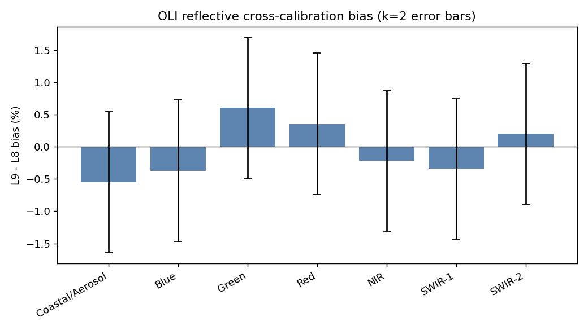
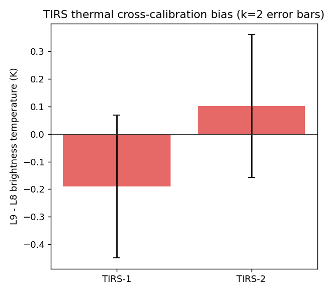
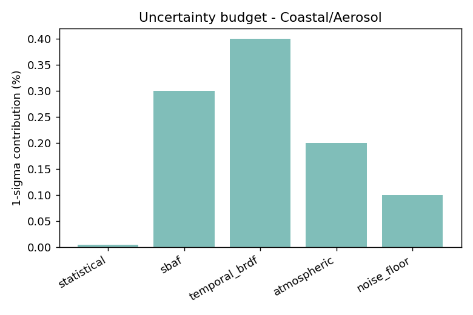
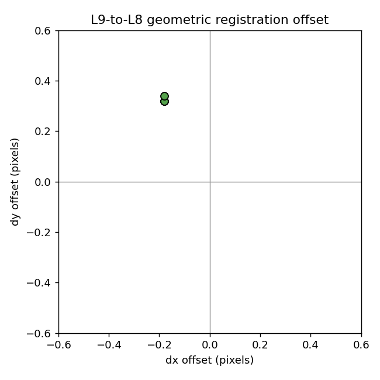

# Landsat 8 / 9 Inter-Sensor Cross-Calibration (OLI & TIRS)

A first-principles, uncertainty-aware **radiometric and geometric cross-calibration**
of the Landsat 8 and Landsat 9 imagers over a pseudo-invariant calibration site (PICS).

Landsat 8 and 9 fly the **same WRS-2 orbit eight days out of phase**, so for a given
path/row they acquire near-coincident, near-identical-geometry scenes. Over a
spatially uniform, radiometrically stable desert site this enables a clean
inter-sensor comparison with minimal confounds — the optical/thermal analog of a
satellite underflight.

This project reproduces, in miniature, the calibration methodology I developed for
passive-microwave sensors (NASA GPM XCAL: three-way GMI/TMI/WindSat radiometric
cross-calibration) and applies it to **electro-optical (OLI)** and
**thermal-infrared (TIRS)** imagery — the same method, a different wavelength and
instrument model.

---

## What it does

1. **Pairs scenes** — finds near-coincident L8/L9 acquisitions over a PICS
   (Libya-4 by default) within an 8-day window.
2. **Radiometric cross-calibration**
   - OLI reflective bands → per-band **TOA-reflectance ratio** (L9/L8).
   - TIRS thermal bands → per-band **brightness-temperature difference** (L9−L8).
   - **Spectral Band Adjustment Factor (SBAF)** places L9 on the L8 spectral
     footing before the comparison, so the residual difference is radiometric,
     not spectral.
3. **Uncertainty budget** — combines statistical, SBAF, temporal/BRDF, atmospheric,
   and noise-floor components in quadrature; reports bias at **k=1 and k=2**, and
   flags whether each band’s bias is significant relative to its own uncertainty.
4. **Geometric cross-calibration** — two tiers:
   - a single **global sub-pixel registration offset** (`geometric.py`) via
     upsampled-DFT phase correlation, and
   - a **tie-point network + RANSAC** affine fit (`tiepoints.py`) that lays a grid
     of chips, estimates a local displacement at each, and fits a spatial
     (translation + scale/rotation/keystone) model while **rejecting cloud/smoke
     outliers** — the area-based analog of a GCP/tie-point workflow.

The calibration science is **decoupled from the data source**: a Google Earth
Engine backend pulls real Landsat Collection-2 TOA data, and a **synthetic backend**
with a known injected bias lets the entire pipeline — and its validation — run
offline with no account required.

---

## Quickstart

```bash
pip install -r requirements.txt

# 1) Offline, synthetic data (no Earth Engine needed) — runs in seconds:
python scripts/run_xcal.py --backend synthetic --site Libya4

# 2) Real data from Google Earth Engine:
#    pip install earthengine-api && earthengine authenticate   (one time)
python scripts/run_xcal.py --backend gee --site Libya4 --project YOUR_EE_PROJECT

# tie-point network + RANSAC geometric registration (synthetic warp + outliers)
python scripts/run_tiepoints.py --grid 8 --chip 64 --outlier-frac 0.2

# tests (validate recovered bias/shift against injected ground truth)
pytest -q
```

The notebook `notebooks/01_xcal_uq.ipynb` walks through the same analysis with
narration and inline figures.

---

## Example output (synthetic backend, self-validating)

The synthetic backend injects a **fixed, known** inter-sensor bias (a sensor
property, constant across scenes) plus per-scene speckle, so the recovered values
can be checked against ground truth:

```
Radiometric cross-calibration (L9 - L8):
  band               bias      k=2 unc   significant?
  Coastal/Aerosol    -0.549%     1.095%    no
  Blue               -0.371%     1.095%    no
  Green              +0.601%     1.095%    no
  Red                +0.355%     1.096%    no
  NIR                -0.216%     1.095%    no
  SWIR-1             -0.337%     1.095%    no
  SWIR-2             +0.205%     1.096%    no
  TIRS-1             -0.190 K    0.258 K   no
  TIRS-2             +0.101 K    0.258 K   no

Geometric registration (L9 -> L8):
  mean offset: 0.37 px  (11.2 m)

Synthetic validation (recovered vs injected):
  Red      recovered +0.355%  injected +0.353%
  TIRS-1   recovered -0.190 K injected -0.188 K
  geometry recovered (dy,dx)=(+0.32,-0.18) px  injected (+0.35,-0.20) px
```

Recovered biases match the injected truth to within the ROI noise level, and the
sub-pixel shift to a few hundredths of a pixel — confirming the estimators and the
uncertainty logic are correct before any real data is touched.

### Figures
| | |
|---|---|
|  |  |
|  |  |

---

## Method notes

**Why a PICS.** Libya-4, Algeria-3 and Railroad Valley (RVUS) are CEOS-endorsed
pseudo-invariant sites: bright, spatially uniform, and radiometrically stable over
time, which minimises surface-change and BRDF confounds in the comparison.

**SBAF.** L8 and L9 relative spectral responses (RSRs) differ slightly. Over a
non-flat surface spectrum this produces an apparent, purely spectral difference.
The SBAF corrects it by RSR-weighted integration of a site reference spectrum
(`sbaf.sbaf_from_rsr`). L8/L9 RSRs are very close, so SBAFs sit within a few tenths
of a percent of unity; the residual RSR-knowledge error is carried in the
uncertainty budget rather than assumed perfect.

**Uncertainty budget.** The reported bias is combined with a 1σ uncertainty built
in quadrature from: statistical (standard error of the per-pair mean), SBAF
residual, temporal/BRDF drift over the acquisition gap, atmospheric residual, and a
noise floor. Priors live in `config.PRIORS` and are meant to be refined from the
data and from published L8/L9 calibration reports.

**Geometric (two tiers).** The global offset uses Guizar-Sicairos upsampled-DFT phase
correlation (the algorithm behind scikit-image’s `phase_cross_correlation`),
implemented here directly so the repo has no heavy image dependency. The
**tie-point network** (`tiepoints.py`) applies that same local matcher over a grid of
chips, then fits a first-order (affine) displacement field by **RANSAC**, labelling
chips whose local match disagrees with the global geometry (clouds, smoke, shadow) as
outliers. The affine field captures the translation plus the small
scale/rotation/keystone difference between two sensors’ line-of-sight models — terms a
single rigid shift cannot.

*Scope, honestly:* this is the tie-point / warp-estimation and accuracy-assessment layer.
Full geolocation correction — DEM-based orthorectification with orbit/attitude (GNSS,
star-tracker) and RPC, plus local thin-plate-spline warping — is the next tier and is out
of scope here. Area-based phase correlation stands in for feature-based tie points
(SIFT/deep matching); the roles are analogous, and this is the layer such a pipeline is
validated against.

---

## Repository layout

```
landsat89-xcal/
├── README.md
├── requirements.txt
├── LICENSE
├── src/landsat_xcal/
│   ├── config.py        sites, date windows, sensor/band defs, uncertainty priors
│   ├── data.py          GEE + synthetic backends (shared output contract)
│   ├── sbaf.py          spectral band adjustment factors
│   ├── radiometric.py   per-band cross-calibration bias (OLI ratio, TIRS ΔBT)
│   ├── uncertainty.py   end-to-end k=1 / k=2 uncertainty budget
│   ├── geometric.py     global sub-pixel registration (phase correlation)
│   ├── tiepoints.py     tie-point network + RANSAC affine registration
│   └── plotting.py      report figures
├── scripts/run_xcal.py        radiometric + uncertainty + global geometry CLI
├── scripts/run_tiepoints.py   tie-point + RANSAC registration CLI
├── notebooks/01_xcal_uq.ipynb
└── tests/test_core.py   validation against injected ground truth
```

## Roadmap / next steps

- Load published USGS L8/L9 OLI & TIRS RSRs and a site reference spectrum to replace
  the placeholder unity SBAFs with computed factors.
- Add Sentinel-2 MSI as a third sensor for a genuine three-way optical cross-cal
  (direct analog of the GMI/TMI/WindSat work).
- Extend the geometric component with DEM-based orthorectification (orbit/attitude +
  RPC) and local thin-plate-spline warping, building on the tie-point network already here.
- Add a per-site geolocation-accuracy time series from the tie-point residuals.

## Author

Ruiyao Chen — PhD, satellite remote sensing; radiometric calibration, inter-sensor
cross-calibration, and uncertainty quantification for NASA missions (TRMM, GPM).

## License

MIT — see [LICENSE](LICENSE).
